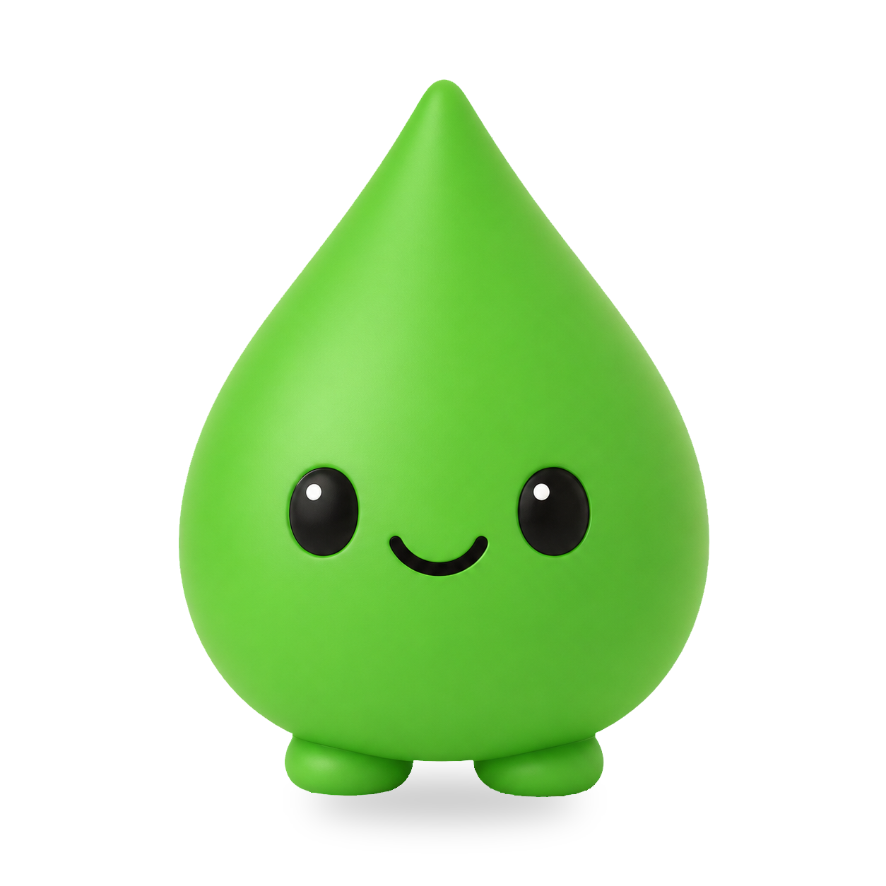
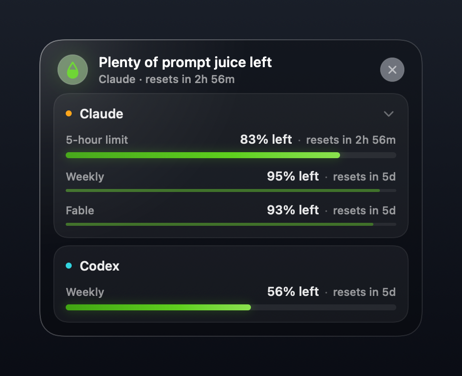

<div align="center">
  
  <h1>PromptJuice</h1>
  <p><strong>Use it or lose it.</strong></p>
  <p>A macOS menu-bar app for your Claude and Codex usage limits.</p>
</div>

PromptJuice sits in your menu bar and shows how much Claude and Codex usage you
have left, and when each limit resets. Click the droplet and the Juicebar pops
open with the details.

Most trackers warn you when you're about to run out. PromptJuice does the
opposite. If you still have a lot left and the limit is about to reset, that
usage is about to go to waste, so the droplet turns orange. That's your cue to
start the big task, run more agents, or switch to a stronger model while the
juice is already paid for.

<div align="center">
  
</div>

## Quick Start

### What you need

- macOS 14 Sonoma or later.
- Git and Swift 6. Xcode 16 or later includes it.
- Claude Code, Codex, or both, installed and signed in.

### Install from source

```bash
git clone https://github.com/jeremyrojas/prompt-juice.git
cd prompt-juice
.agents/skills/promptjuice-install/scripts/install_promptjuice.sh
```

The script builds `PromptJuice.app`, puts it in `/Applications` (or
`~/Applications` if that isn't writable), and opens it. On first launch you pick
Claude, Codex, or both.

If macOS blocks the app, right-click `PromptJuice.app`, choose **Open**, and
confirm.

### Install with an AI agent

Paste this into your coding agent:

```text
Clone https://github.com/jeremyrojas/prompt-juice.git, read README.md and .agents/skills/promptjuice-install/SKILL.md, then follow the skill to build, install, and open PromptJuice on this Mac.
```

### Update

From a PromptJuice checkout with no uncommitted changes:

```bash
.agents/skills/promptjuice-update/scripts/update_promptjuice.sh
```

It pulls the latest for the branch you're on, rebuilds the app, swaps out the
installed copy, and reopens it. Or ask your agent:

```text
Read .agents/skills/promptjuice-update/SKILL.md and follow it to update my installed PromptJuice app from GitHub.
```

## What You Get

- **A droplet in your menu bar.** Its fill follows whichever provider has the
  least left on its main limit. It turns orange when it's time to use some.
- **The Juicebar.** One card per provider, with every limit it reports: 5-hour,
  Weekly, and per-model limits like Fable. Click a provider to expand or
  collapse it.
- **An orange nudge.** It shows up when a limit has plenty left and is close to
  resetting. You decide how close and how much, separately for 5-hour and
  weekly limits.
- **An optional notification.** macOS can ping you for that same nudge. It's off
  until you turn it on in Settings.
- **Readings that stick around.** If a check fails, PromptJuice keeps the last
  good reading until that limit resets.

### Getting around

- Left-click the droplet to open the Juicebar. It opens at the top center of
  your screen.
- Drag the Juicebar anywhere and it pins itself there, so it stays open while
  you work. Closing it un-pins it.
- Right-click the droplet for **Show Usage**, **Pin Juicebar**, **Settings**,
  and **Quit PromptJuice**. Pin Juicebar brings it back to the last spot you
  dragged it to.

### When the droplet turns orange

Out of the box:

| Limit | Nudges when it resets within | And you still have at least |
| --- | --- | --- |
| 5-hour | 60 minutes | 40% |
| Weekly | 1 day | 40% |

You can change all four in Settings. Two more rules keep the nudge honest:

- A limit you've barely touched (under 5% used) doesn't nudge.
- A 5-hour limit doesn't nudge when your weekly limit is nearly gone (under 5%
  left), since there's not much juice to spend.

When a weekly limit hits 0%, the Juicebar tells you that provider is out and
when it comes back.

## How PromptJuice Reads Usage

Everything is read on your Mac. To see where a number came from and when, hover
over a provider in the Juicebar. A `~` in front of a percentage means it's an
estimate. Settings shows the same status for each provider.

### Codex

PromptJuice finds your local Codex, starts `codex app-server`, and asks it for
your rate limits (`account/rateLimits/read`). It shows every limit Codex
reports. Codex Pro currently reports only a Weekly limit. Plans with a 5-hour
limit show that one first, with Weekly behind the expand arrow. That second
layout comes from test fixtures and hasn't been checked on a real non-Pro
account yet.

It looks for Codex in the ChatGPT app, the older Codex app, Homebrew, and then
your `PATH`. If yours lives somewhere else, point to it:

```bash
export PROMPTJUICE_CODEX_PATH="/Applications/ChatGPT.app/Contents/Resources/codex"
```

### Claude

PromptJuice finds Claude Code (2.1.208 or newer), checks that you're signed in
with a subscription, then opens Claude Code in its own empty workspace and reads
the built-in `/usage` screen. It sends no prompts to the model. You get the same
numbers you'd see in Claude Code yourself.

It checks when the app launches, when your Mac wakes, when you open the
Juicebar, when a limit resets, and on a slow timer in between. If Claude
rate-limits a check, PromptJuice backs off: 5, 15, 30, then 60 minutes.

If it can't get a direct reading, it shows an estimate from Claude Code's local
activity logs. If something needs fixing, Settings walks you through it:
install, sign in, update, or trust the workspace.

On API billing or an external provider like Bedrock or Vertex, there's no plan
limit to read, so PromptJuice shows "Claude plan usage unavailable".

If Claude Code lives somewhere unusual, set `PROMPTJUICE_CLAUDE_PATH`.

More detail and troubleshooting:
[Provider Integrations](docs/provider-integrations.md).

## Privacy

PromptJuice has no analytics, no account, and no server. The app makes no
network requests of its own.

- Codex numbers come from the Codex process on your Mac.
- Claude numbers come from Claude Code's `/usage` screen.
- Claude estimates come from Claude Code's local activity logs.
- PromptJuice also reads Claude Code's local settings, to tell whether you're on
  a subscription.
- Its cache holds only the usage numbers and when they were read.

Claude Code and Codex still talk to their own services the way they always do.

## Develop

Build and open a local app bundle:

```bash
./scripts/run_app.sh
```

Run the tests:

```bash
swift test
```

Build a release bundle:

```bash
CONFIGURATION=release ./scripts/build_app.sh
```

The bundle lands in `build/PromptJuice.app`. On every pull request and push to
`main`, GitHub Actions builds the app, runs the Swift and Python tests, lints
the shell scripts, and verifies the release bundle.

## Status

PromptJuice is an early preview that you build from source. Not here yet:

- A signed, notarized download.
- Automatic updates.
- Launch at login.
- A live check of the lower-tier Codex layout.

Local builds are signed with a fixed ad-hoc identity, so macOS remembers your
notification permission between rebuilds.

## Project Map

```text
app/PromptJuice/       App lifecycle, UI, models, providers, and services
app/PromptJuiceTests/  Unit, integration, and snapshot tests
.agents/skills/        Install and update workflows for AI agents
design/                State board and visual assets
docs/                  Provider notes, privacy review, and the states reference
scripts/               Build, run, icon, and Claude capture helpers
```

## Documentation

- [Product overview](docs/prompt-juice.md)
- [Provider integrations](docs/provider-integrations.md)
- [States and colors](docs/reference/states-and-colors.md)
- [Usage state board](design/prompt-juice-states.html)

## License

PromptJuice source code and documentation are available under the
[MIT License](LICENSE). Contributions are accepted under the same license.
The PromptJuice name, logo, and app icon are covered by the
[trademark policy](TRADEMARKS.md).

Don't waste the juice.
