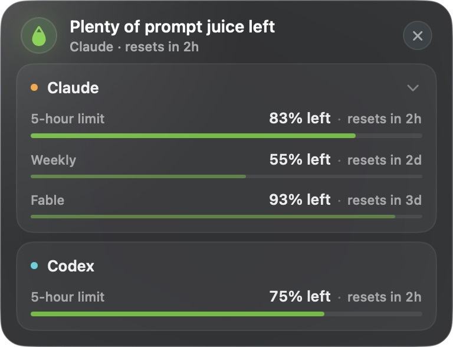
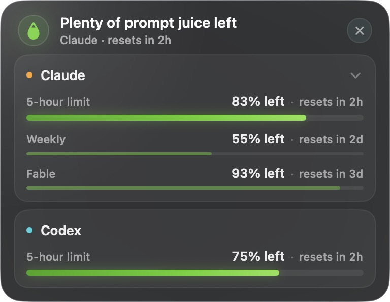
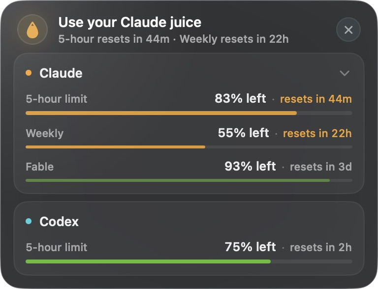
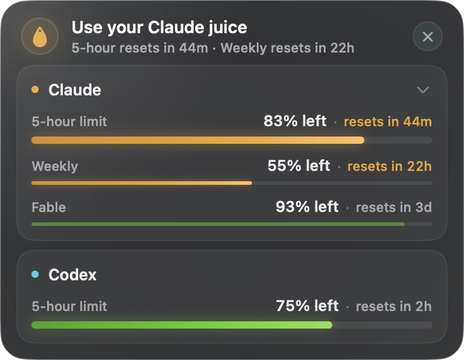
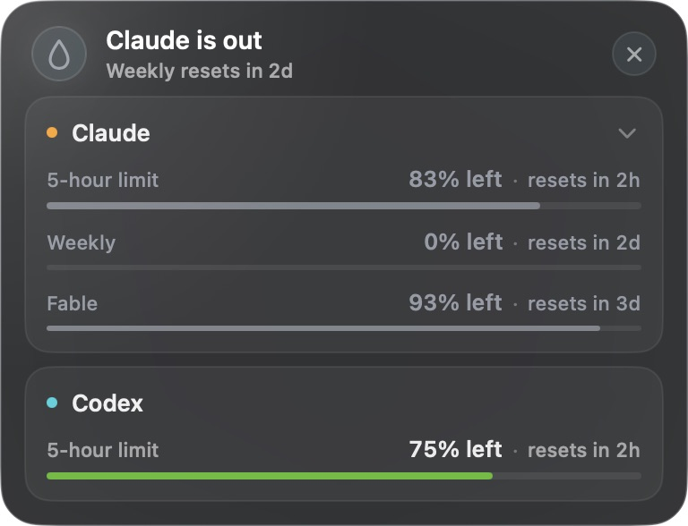
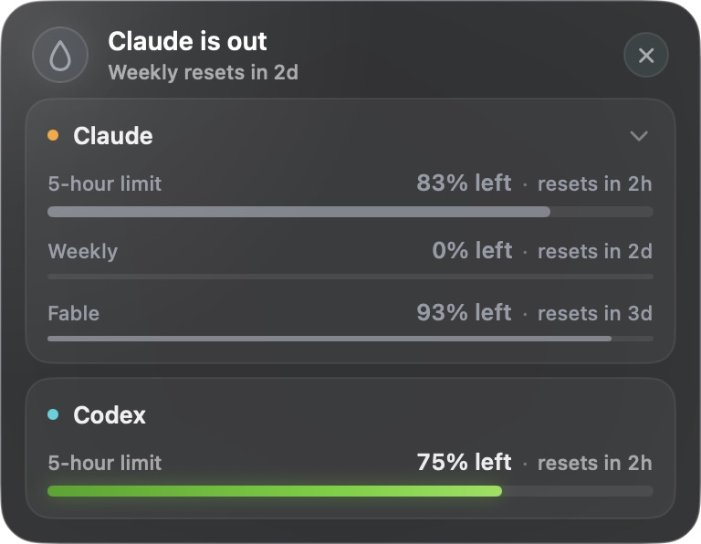

# PromptJuice — States & Colors Reference

Canonical reference for Juicebar severity, provider freshness, and aggregate presentation.

## 1. Color palette

Source: [`SeverityAppearance.swift`](../../app/PromptJuice/UI/SeverityAppearance.swift)

| Token | Hex | Use |
| --- | --- | --- |
| `green` | `#5FD11F` | healthy bars; bright for the main limit, subdued for extras |
| `orange` | `#F0A32A` | use-soon reset text and bar |
| `muted` | `#969CA6` | calm low, empty, or unavailable |

Provider identity dots use `#FF9F0A` for Claude and `#32D4DE` for Codex. Healthy main bars brighten from leading to trailing: `#3FA512` at 0%, `#5FD11F` at 62%, and `#8BE24E` at 100%. Their soft glow uses `#5FD11F` at 38% opacity with a 5-point radius and zero offset. Healthy extra-limit bars stay flat green at 42% opacity with no glow.

Every use-soon bar brightens from `#D9880F` at 0%, through `#F0A32A` at 58%, to `#FFC15E` at 100%. Its glow uses `#F0A32A` at 42% opacity with zero offset: a 6-point radius on the main row and 3 points on extra limits. The healthy main glow stays weaker than the amber main glow; amber remains the only nudge. Low, empty, unavailable, and provider-lockout rows stay flat muted at 72% opacity with no glow. These treatments have no animation.

Computer-tested panel captures with Claude expanded and local fixture readings:

| State | Before | After |
| --- | --- | --- |
| Healthy |  |  |
| Use soon |  |  |
| Weekly lockout |  |  |

## 2. Severity axis

Source: [`UsageSeverity.swift`](../../app/PromptJuice/Models/UsageSeverity.swift) and [`AlertEngine.swift`](../../app/PromptJuice/Services/AlertEngine.swift)

| Severity | Trigger | Bar | Notification |
| --- | --- | --- | --- |
| `empty` | a window has 0% left | muted | — |
| `useSoon` | reset is within its cadence threshold, enough remains, and at least 5% was used this cycle | orange | eligible |
| `low` | a window has less than 15% left | muted | — |
| `healthy` | other usable windows | bright green for the main bar, subdued green for extra limits | — |
| `unavailable` | no usable reading | muted | — |

There are no status chips in measured cards. The percentage remains white on an amber row; its reset text and bar turn amber. Low stays calm.

The 5-hour defaults are 60 minutes and 40% remaining, with 30/45/60/90 minute choices. Weekly defaults are 1 day and 40% remaining, with 12 hours / 1 day / 2 days / 3 days choices. Both percentage pickers offer 25/40/50/60%. Other Codex durations use the 5-hour pair below 1 day and the weekly pair from 1 day up.

The provider verdict and droplet fill follow the main (shortest-cadence) window. Any amber window turns the verdict and droplet amber. An exhausted all-models Weekly locks the provider: every row on its card becomes muted, and the header subtitle names when Weekly resets. An exhausted model-specific weekly such as Fable mutes only its own row.

## 3. Confidence and source

Source: [`SnapshotConfidence.swift`](../../app/PromptJuice/Models/SnapshotConfidence.swift) and [`SnapshotSource.swift`](../../app/PromptJuice/Models/SnapshotSource.swift)

| Confidence | UI meaning |
| --- | --- |
| `exact` | current provider reading |
| `stale` | valid earlier exact window |
| `estimated` | local activity-based approximation |
| `unavailable` | no usable quota window |

Claude sources are `claudeUsageCLI`, `claudeCache`, and `claudeLocalLogs`. Codex sources are `codexAppServer` and `codexCache`.

## 4. Claude presentation state

Source: [`ClaudeUsagePresentation.swift`](../../app/PromptJuice/Models/ClaudeUsagePresentation.swift)

Claude presentation resolves account access, refresh state, reading availability, and provider enablement into one state:

| State | Row / Settings behavior | Action |
| --- | --- | --- |
| checking | shows cached reading when available; otherwise `Checking…` | — |
| current | exact value with freshness clock | — |
| saved | valid earlier value with freshness clock | — |
| out of quota | 0% until reset | — |
| backing off | carries reading when available and shows next-check time | — |
| CLI missing | direct reading unavailable; estimate may remain visible | Install |
| signed out | direct reading unavailable; estimate may remain visible | Sign In |
| update required | direct reading unavailable; estimate may remain visible | Update |
| workspace trust required | direct reading unavailable; estimate may remain visible | Trust |
| API billing | neutral, excluded from quota aggregate | — |
| external provider | neutral, excluded from quota aggregate | — |
| unsupported authentication | neutral, excluded from quota aggregate | — |
| failure | cached or estimated reading remains when usable | Retry |
| off | Claude row hidden from downstream aggregate state | — |

Freshness text has five tiers: just now, minutes ago, clock time today, yesterday with clock time, and month/day with clock time.

## 5. Rows and interaction

Each measured provider card has a header and one row per visible limit. The rows show a label, remaining percentage, reset countdown, and 6-point main or 3-point secondary bar. The glow spills past the bar within the card padding; neither the bar frame nor the card shape clips it. Card height, panel height, and click routing share the same bar-height constants. Cards grow with their visible rows. The chevron expands or collapses each provider independently, and the choice survives relaunch. A hidden amber window appears while the card stays collapsed; a low window stays tucked away. When the all-models Weekly reaches 0%, the collapsed card also shows that muted Weekly row so the provider’s “is out” header has its explanation. An empty model-specific weekly stays tucked away. Every positive fill is at least as wide as its bar height (6 points main, 3 points secondary), keeping even 1% capsule-shaped; 0% has no fill. Hidden windows still participate in alerts and notifications.

Countdowns are floored from the reset timestamp: minutes below 1 hour; hours and remaining minutes from 1 to under 3 hours; hours from 3 to under 24 hours; days and remaining hours from 1 to under 3 days; days from 3 days up. Zero remainders are omitted (`2h`, `2d`). Rows, header subtitles, and notification bodies share this format. Claude prerequisite states can show a compact journey button. Measured provider rows stay display-only. The Settings row includes an information popover describing direct `/usage` reads, the local estimate, and the current state.

The header names a single amber window, a provider when several of its windows are amber, or “juice” when both providers are involved. It ranks the soonest reset first, joins windows with the same reset boundary, and uses a count plus the soonest reset when the full line would not fit within 272 points. If naming that window still exceeds the width, the count form uses `next in 1h 30m` (or the corresponding duration).

## 6. Notifications

When **Notify me** is on, each qualifying window can contribute one notice per reset cycle, even while collapsed. PromptJuice combines simultaneous notices into one macOS banner using the panel header wording. It records a latch for each provider and window kind.

## 7. Menu-bar glyph

| Property | Rule |
| --- | --- |
| Tint | orange when any visible provider is `useSoon`; plain otherwise |
| Fill | main-window remaining for the provider with the soonest amber limit; otherwise the lowest available main-window remaining; 0 for an all-models Weekly lockout |
| Redraw | approximately every second, deduplicated by percentage and severity |

## 8. Enabled providers and aggregates

Enabled providers define rows, headline, severity, glyph, notifications, and click routing. At least one provider remains enabled.

Available quota-bearing snapshots participate in the aggregate. Claude API-billing, external-provider, and unsupported-authentication categories are neutral and stay outside quota aggregation. Worst severity wins, with `useSoon` taking priority so the time-sensitive nudge remains visible.
